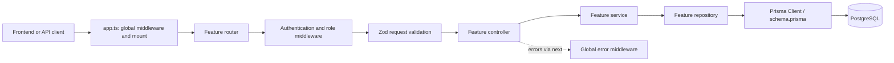

# Backend Structure and Request Flow

This guide maps the MockMate backend so you can find each layer and explain how a request moves through it. The backend is in `apps/backend`; frontend routes and screens are in `apps/frontend`.

## Backend at a glance

```text
apps/backend/
├── prisma/
│   └── schema.prisma          # Database models, enums, relations, indexes
└── src/
    ├── server.ts              # Process startup, database check, Socket.IO, schedulers
    ├── app.ts                 # Express setup, global middleware, route mounting, errors
    ├── config/                # Environment parsing and runtime configuration
    ├── middleware/            # Shared authentication, role checks, validation, errors, limits
    ├── modules/               # Feature-oriented HTTP and business logic
    │   └── <feature>/
    │       ├── <feature>.routes.ts       # URL/method and middleware composition
    │       ├── <feature>.controller.ts   # HTTP request/response adapter
    │       ├── <feature>.service.ts      # Business rules and coordination
    │       ├── <feature>.repository.ts   # Database or mock data access
    │       └── <feature>.validator.ts   # Zod request schemas (where needed)
    ├── infrastructure/        # External-system adapters, currently AI/Groq
    ├── lib/                   # Shared clients and integrations (Prisma, auth, LiveKit, etc.)
    ├── mockStore/             # In-memory stores used in explicit memory mode
    └── types/                 # Express request types and API response helpers
```

Some modules do not need every file. For example, notifications have no request validator for the current routes. Add a layer only when that feature needs it.

## What each layer owns

| Layer | Folder or file | Responsibility | Keep out of this layer |
| --- | --- | --- | --- |
| Router | `modules/<feature>/<feature>.routes.ts` | Declares endpoints and orders middleware before controller handlers | Business rules and database queries |
| Middleware | `src/middleware/` | Reusable cross-route checks and request processing: identity, role, validation, rate limiting, error formatting | Feature-specific workflows |
| Controller | `modules/<feature>/<feature>.controller.ts` | Reads validated request data, calls a service, chooses HTTP status/response shape | Prisma queries and domain decisions |
| Service | `modules/<feature>/<feature>.service.ts` | Enforces business rules and coordinates repositories/other services | Express response formatting |
| Repository | `modules/<feature>/<feature>.repository.ts` | Reads/writes persistence and maps results needed by the service | HTTP status codes and UI behavior |
| Model | `prisma/schema.prisma` | Defines persisted entities, fields, relations, enums, and indexes | Request handlers or business workflows |
| External adapter | `infrastructure/` and `lib/` | Wraps providers such as Groq, LiveKit, Better Auth, and Prisma | Route composition |

### Where are the models?

There is no duplicate TypeScript `models/` directory. Prisma is the model definition: edit `apps/backend/prisma/schema.prisma`, then use the generated Prisma Client types in repositories. This avoids maintaining one set of database models and a second hand-written set that can drift.

The main product models are `User`, `InterviewerProfile`, `AvailabilitySlot`, `BlockedSlot`, `Booking`, `Payment`, `Interview`, `Message`, `CodeSnapshot`, `Feedback`, `Review`, `Notification`, `Tag`, and `InterviewerTag`. `Session`, `Account`, and `Verification` support Better Auth. Enums such as `UserRole`, `BookingStatus`, `InterviewStatus`, and `PaymentStatus` describe allowed states.

Shared API contracts and enums used by both apps live in `packages/shared`; database relations and persistence fields remain in Prisma.

## Shared middleware

- `auth.middleware.ts`: `requireAuth` establishes `req.user`; `requireRole(...)` performs role-based access control after authentication.
- `validate.ts`: validates body, query, or params using a feature's Zod schema before the controller runs.
- `error.middleware.ts`: converts thrown/forwarded errors into the common API error response.
- `rateLimiter.ts`: applies request-rate limits.

Middleware order matters. For example, protected feature routers use `requireAuth` before handlers; role-specific endpoints then use `requireRole`. The booking router shows this pattern in `modules/booking/booking.routes.ts`.

## Request lifecycle



`server.ts` starts the process. `app.ts` configures Express, installs global middleware, mounts routers, and installs 404/error handling. The app's routers are mounted under `/api/v1`; Better Auth is separately mounted at `/api/auth/*`, and `/health` is a health check.

## Example: candidate creates a booking

1. The frontend sends `POST /api/v1/bookings` with the interviewer's profile, chosen time, and booking options.
2. `app.ts` applies global middleware and dispatches `/api/v1/bookings` to `bookingRouter`.
3. `booking.routes.ts` runs `requireAuth`, then `validate(createBookingSchema)`, then `BookingController.create`.
4. `booking.controller.ts` passes the authenticated user's ID and validated body to `BookingService.createBooking` and returns the HTTP response.
5. `booking.service.ts` checks domain rules: interviewer exists, candidate is not booking themself, time is offered, rate is valid, and payment/credit rules are satisfied.
6. `booking.repository.ts` persists the booking through Prisma (or uses the explicitly selected mock store in memory mode).
7. The result travels back through the service and controller. If a layer throws an error, `next(error)` sends it to `error.middleware.ts` instead.

That same path applies broadly: **router → middleware → controller → service → repository → model/database**. Not every route uses every middleware or every layer.

## Where to start reading

For the clearest backend walkthrough, read these in order:

1. `apps/backend/src/server.ts` — how the process starts.
2. `apps/backend/src/app.ts` — global middleware and route map.
3. `apps/backend/src/modules/booking/booking.routes.ts` — endpoint and middleware order.
4. `apps/backend/src/middleware/auth.middleware.ts` and `validate.ts` — shared request guards.
5. `apps/backend/src/modules/booking/booking.controller.ts` — HTTP adapter.
6. `apps/backend/src/modules/booking/booking.service.ts` — business rules.
7. `apps/backend/src/modules/booking/booking.repository.ts` — persistence operations.
8. `apps/backend/prisma/schema.prisma` — persisted model definitions and relations.

Then follow the same files for `availability`, `payments`, or `interview` to compare how other features use the layers.

## Frontend map

- `apps/frontend/src/app/`: Next.js routes and page composition.
- `apps/frontend/src/features/<feature>/`: feature UI components; forms and widgets live with the feature they serve.
- `apps/frontend/src/components/`: shared application components, including navigation.
- `apps/frontend/src/components/ui/`: reusable primitive UI components.
- `apps/frontend/src/lib/`: shared frontend clients and helpers, including the API client and auth context.

The frontend makes HTTP requests to the backend API. For live interview behavior, it also connects to LiveKit and Socket.IO through their feature components and backend integrations.

## Interview explanation in one minute

> “The backend is organized by feature. Each feature has routes, a controller, service, and repository. Routes compose authentication, role checks, and Zod validation. Controllers translate between Express and the service layer. Services enforce business rules, and repositories isolate Prisma persistence. Prisma's schema is the source of truth for database models; shared API enums and contracts are in `packages/shared`. Global middleware and app wiring live outside the feature modules, so cross-cutting behavior is in one place.”
